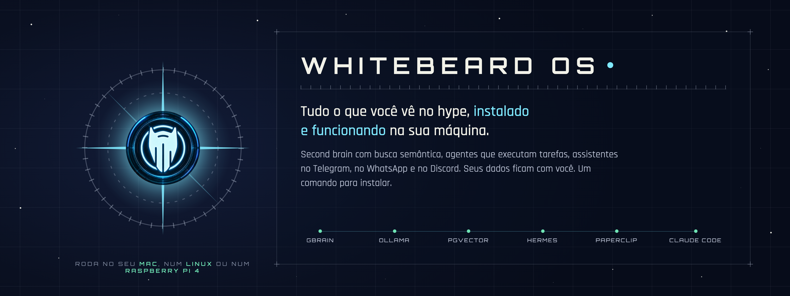
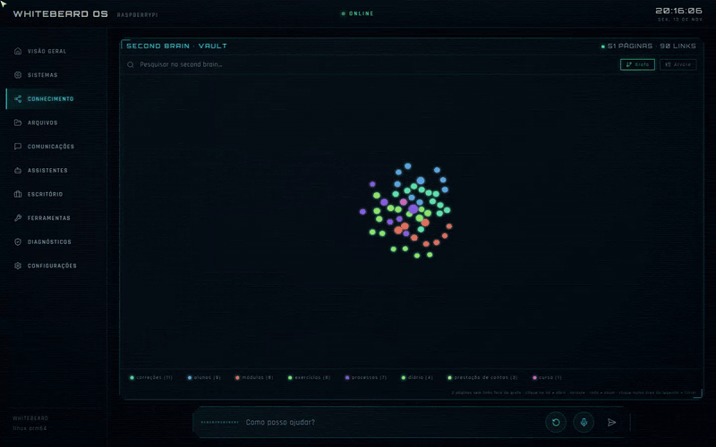
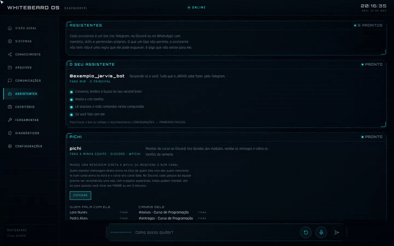
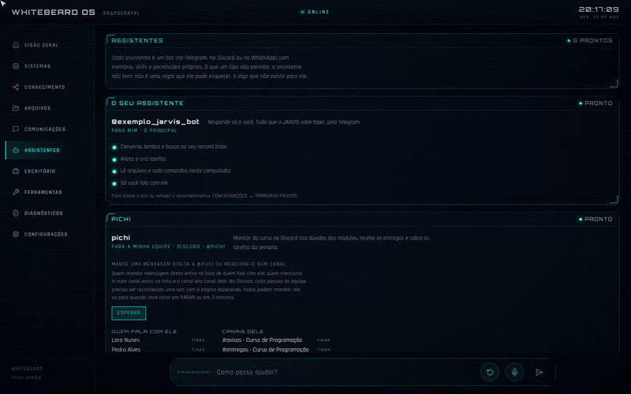
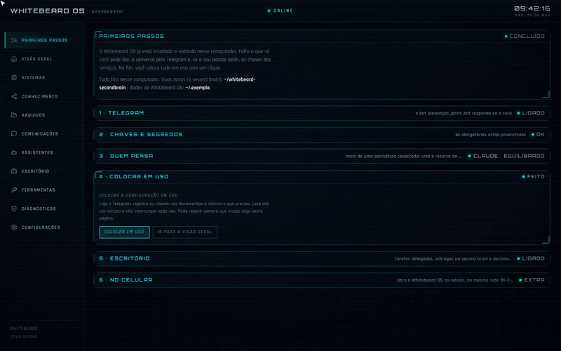
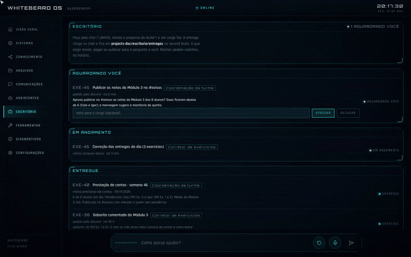
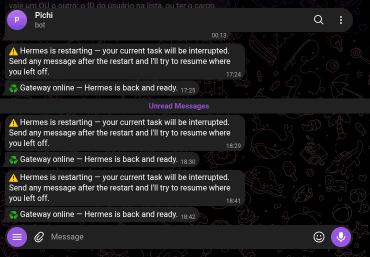
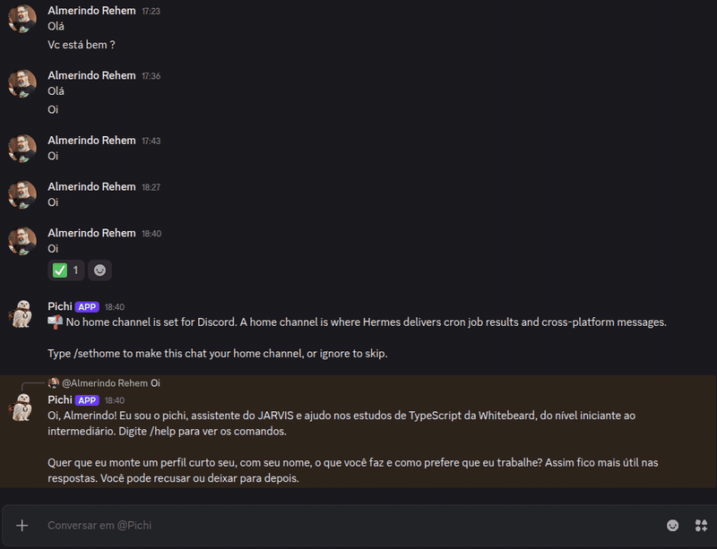
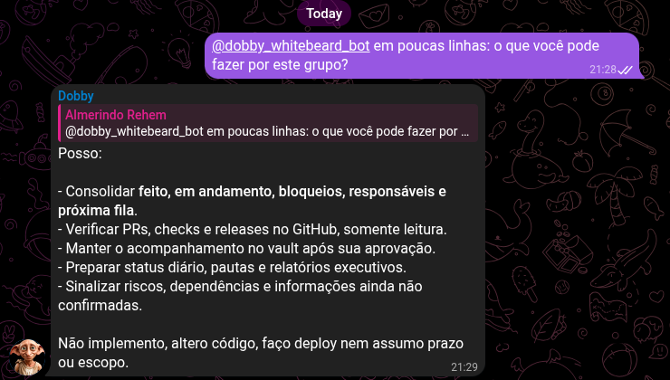
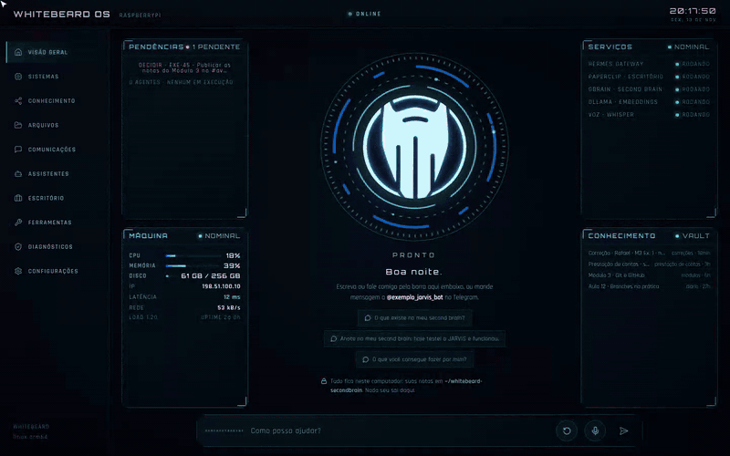

<p align="center"></p>

<p align="center"><b>English</b> · <a href="README.pt-BR.md">Português</a></p>

<h1><picture><source media="(prefers-color-scheme: dark)" srcset="docs/marca/whitebeard-os-titulo-branco.png"></picture></h1>

**Everything you see in the hype, installed and working on your own machine. In one command.**

A second brain with semantic search. Agents that work on their own, on schedule. One bot on Telegram, another on
Discord, another on WhatsApp, each with its own memory and its own rules. Every day someone is talking about one of
these pieces. The hard part was never knowing they exist: it is making all of them work together, on your computer,
with your data, without turning into a weekend project that never ends.

I am **Almerindo Rehem**, a software engineer and the founder of <a href="https://whitebeard.dev"><picture><source media="(prefers-color-scheme: dark)" srcset="docs/marca/whitebeard-wordmark-branco.png"></picture></a>. Whitebeard OS is the setup I use every
day, at home and at work, packaged so you can install it with one command and use it from your browser. It runs even on
a **Raspberry Pi**.

```sh
curl -fsSL https://raw.githubusercontent.com/whitebeardit/whitebeard-os/main/install.sh | sh
```

> The interface speaks **English** (the default) and **Brazilian Portuguese**: it follows your browser language, and you
> can switch in SETTINGS → LANGUAGE. The recordings below were made with the Portuguese interface, so button and page
> names are quoted as they appear in them, with a translation next to them.

<p align="center"></p>

<p align="center"><a href="#ask-your-second-brain">Second brain</a> ·
<a href="#one-bot-per-channel-in-three-steps">Bots per channel</a> ·
<a href="#each-bot-with-its-own-role-and-model">Types and models</a> ·
<a href="#the-office-work-that-runs-on-its-own">Office</a> ·
<a href="#on-telegram-and-discord-for-real">Telegram and Discord</a> ·
<a href="#your-way">Themes</a> ·
<a href="#runs-wherever-you-want">Install</a></p>

> **A real case.** The screens below follow a bot that is already live on a Raspberry Pi: **@Pichi**, the teaching
> assistant of a programming course on Discord. The course plan: answer questions about the modules, grade the
> exercises and, every Monday, post each student's weekly check-in to the channel. The screens show that setup with
> fictional students and grades; the Telegram and Discord conversations at the end are real.

## Ask your second brain

Your Markdown notes (they open in Obsidian) become a brain with semantic search: embeddings generated on your machine,
a graph of links, a tree of maps and search. JARVIS and every bot query the same brain. Nothing leaves your computer.

<p align="center"></p>

## One bot per channel, in three steps

Choose who it is for and where it talks (Telegram, Discord or WhatsApp), paste the bot token and click ESPERAR
(wait): whoever messages the bot during that window joins the list of people who can talk to it. Several people at
once, until you click PARAR (stop).

<p align="center"></p>

## Each bot with its own role and model

Each bot's limits are structural: what its type does not allow, it simply does not have installed. It is not a rule
in a prompt that it can forget.

| Type | What for | In the course |
| --- | --- | --- |
| **Para mim** (for me) | A second assistant that is only yours | the owner's JARVIS, on Telegram |
| **Para a minha equipe** (for my team) | Answers the people you allow; reads and writes to the second brain | @Pichi on Discord and the front desk on WhatsApp |
| **Para um cliente** (for a client) | Serves one group, only within its role, with no tools | the group of the company sponsoring scholarships (and, for real, the Sauvvitech group, below) |
| **Só rotinas** (routines only) | Does not chat; posts announcements on schedule | the weekly calendar |

Each bot also picks **the subscription** (Claude or ChatGPT, your own, no API key; or free models through OpenRouter) and **the level** (Rápido/fast,
Equilibrado/balanced or Mais capaz/most capable). The page shows which model each choice uses, and the other connected
subscription becomes an automatic fallback.

<p align="center"></p>

### Test with a free model (OpenRouter)

You do not need a paid plan to put a bot to the test. **OpenRouter** is the third option in QUEM PENSA ("who
thinks"), next to Claude and ChatGPT: create a free key at [openrouter.ai/keys](https://openrouter.ai/keys), paste it
on the page and the three levels start using **free models**. Use it for everything, or only on the bot you are
trying out (EDITAR → ASSINATURA DELE, "its subscription"). With Claude or ChatGPT also connected, OpenRouter becomes
the automatic fallback when the main one runs out.

Free models have a daily request limit and are slower and less capable than the paid ones: good for testing and for
simple bots, not for heavy work.

<p align="center"></p>

## The Office: work that runs on its own

Work that takes time leaves the chat. You ask JARVIS, a **role** carries it out (an agent with a defined job) and the
result comes back to the chat and stays in the second brain. **Routines** create the task by themselves, on schedule.
Anything that would send, pay or publish **stops and asks you** first.

In the course, the Office (ESCRITÓRIO) has three roles and three routines:

| Routine | When | Role | Where it posts |
| --- | --- | --- | --- |
| Grade the day's submissions: grades with the rubric, points out the mistake with an example and never hands over the answer | every day, 10 pm | Exercise grader | in @Pichi's channel |
| Assignment reminders: reminds whoever has not submitted yet, with the deadline | Wednesday and Friday, 6 pm | Class coordination | in @Pichi's channel |
| Weekly check-in: what each student submitted, what is late, and the average | every Monday, 9 am | Class coordination | in @Pichi's channel |

<p align="center"></p>

Token usage shows up per subscription, per role, per routine and per task, with an alert when something is out of the
ordinary.

## On Telegram and Discord, for real

The same Pichi, running on a Raspberry Pi, answers on both channels with the same memory and the same second brain.
Two student questions, in direct messages:

<table>
<tr>
<td width="45%" valign="top"><b>Telegram</b><br></td>
<td width="55%" valign="top"><b>Discord</b><br></td>
</tr>
</table>

### In a client group

**Dobby** serves the **Whitebeard → Sauvvitech** group on Telegram: a "for a client" bot that follows the project
with the people in the group and knows where its job ends. Asked in the group itself what it can do:

<p align="center"></p>

## Your way

Three themes (HUD, Atlas estelar and Carmesim), text size and voice, in CONFIGURAÇÕES (settings). Changes apply
instantly, on this device.

<p align="center"></p>

## What's inside

| You've heard of | In Whitebeard OS it is |
| --- | --- |
| **Second brain** | Your Markdown vault (opens in Obsidian), synced every 2 minutes with **GBrain**, the brain that indexes everything and answers through semantic search |
| **Embeddings and pgvector** | **Ollama** running the `bge-m3` model on your machine; GBrain with PGLite on the Mac and **pgvector** in Docker on Linux. Nothing leaves your computer |
| **MCP** | The brain is plugged in as the `knowledge` MCP server in Claude Code and in every agent: they all query the same second brain, each with its own key |
| **Agents with autonomous tasks** | The **Office**: you ask in the chat, a role carries it out through **Hermes**, the result comes back to the chat and stays in the vault. Routines run on schedule. Anything that would send, pay or publish stops and asks you |
| **Paperclip** | The task and approval engine under the Office, already configured |
| **Claude Code, ChatGPT and OpenRouter** | Your subscription is the account the agents use (the Claude Code login; ChatGPT signs in with a device code). Or **free models** through OpenRouter, with a free API key, to test. Skills and MCPs already installed |
| **Telegram, WhatsApp, Discord** | Assistants isolated by audience: one bot per channel, each with its own memory, skills, permissions and model, created in three steps |
| **Voice** | Talk to the assistant through the interface: local transcription with Whisper and a spoken answer in Portuguese |
| **Interface** | A web page on your computer or phone (installs as an app, with a QR code): overview, knowledge, assistants, office, token usage, diagnostics |

## Runs wherever you want

It runs on a **Raspberry Pi**: that is where Pichi lives, answering on Telegram and on Discord. It runs on the Mac
(Apple Silicon, no Docker) and on any Linux. Interface, core and knowledge go on the same machine by default, or on
separate machines.

```sh
curl -fsSL https://raw.githubusercontent.com/whitebeardit/whitebeard-os/main/install.sh | sh
```

The installer only asks for what is missing, brings everything up as user services (no administrator password) and
opens the interface in your browser. Updates arrive through the interface itself.

**What you don't have to decide:** vector database, embedding model, ingestion pipeline, system prompt, MCP
configuration, isolation between the client bot and the team bot. It is all decided and tested.

## For companies

This is my personal setup, free for personal use. The same foundation serves corporate use: tenants per area,
assistants per client, roles per job, a second brain per team, all on your infrastructure. Commercial use requires a
license ([details](#license)); talk to Whitebeard: **[whitebeard.dev](https://whitebeard.dev)**.

<sub>Included today: Hermes, Paperclip, GBrain, Ollama with `bge-m3`, Claude Code, Node 24, ffmpeg with Whisper;
versions pinned in `kernel/versions.env`, licenses in [External components and licenses](#external-components-and-licenses).
Screens recorded with sample data; high-resolution images and videos in the
[press kit](docs/midia/README.md) (in Portuguese).</sub>

---

## Under the hood: the installable kernel

It installs the JARVIS architecture (Claude Code, skills, MCP clients, Hermes) on a **clean** host, from a tenant
declaration (`jarvis.yaml`), **without carrying any company's knowledge or private data**.

Project goal: take an agent architecture that already runs in production in a company's daily work and turn it into a
**product that other people download and install**. The first user is the company that maintains it (dogfooding); the
structure is a product from day one.

This repository is the **kernel**: mechanism. Identity (names, chats, accounts, business skills, secrets) lives in a
separate, private **tenant package**, pointed to on the command line. The rule that separates the two:

> Mechanism goes in the kernel; identity stays in the tenant. A tenant value in kernel code = CI failure.

Three layers:

| Layer | What it is | Where it lives | Example |
| --- | --- | --- | --- |
| **kernel** | required mechanism | this repository | bootstrap, tenant schema, lint, method skills |
| **packs** | optional, installable mechanism | `packs/` (future) | generic CRM, Brazilian tax domain, Instagram |
| **tenant** | identity and data | the user's private repository | `jarvis.yaml`, business skills, secrets |

## The package and where each part runs

The full package has three roles, and **by default all three are installed on the same machine** (all-in-one).
Splitting across machines is an option, declared in `nos:` in `jarvis.yaml`, not the default.

| Role | Components | Needs |
| --- | --- | --- |
| **desktop** | Claude Code, skills, MCP clients, JARVIS Web (browser UI, built from the app and registered as a user service), Hermes CLI | only `$HOME` and an SSH key with access to the app repository |
| **core** | Hermes (Telegram gateway + crons), Paperclip (Node + embedded Postgres) | an always-on host |
| **knowledge** | GBrain (MCP + vault ingestion), pgvector, Ollama (embeddings), in Docker Compose | Docker (Linux) or Docker Desktop/OrbStack (macOS) |

Without `--role`, `bootstrap.sh` installs the roles of this machine's node in the tenant's `nos:`: `local`,
`localhost` or the host name (short name, or the FQDN if the tenant writes it with a domain). Without `nos:`, all
three: all-in-one; with `nos:` but no node that is this machine, it stops and asks for `--role`. A role on another
machine is just another host in `nos:` with its roles; the tenant's MCPs and URLs point there. Missing required secrets
are asked for in the terminal (`--no-prompt` turns this off). Without Docker, the knowledge role is postponed with a
warning and the others continue.

**Decision layer with a pluggable provider.** Routing messages, classifying intents and applying guardrails are closed
questions, and the kernel handles them through its own abstraction: versioned typed questions, a confidence threshold
and escalation to the LLM or to a human. The tenant picks the provider in `decisoes.provider`: `regras`
(deterministic, the default), `llm` (models already configured) or `jev` (TypeSafe AI's decision model, over an API,
with `TYPESAFE_API_KEY`). No external provider is required, and `perfis_excluidos` keeps content from certain profiles
from leaving the machine.

**GPU is optional, never required.** `aceleracao: auto` in `jarvis.yaml` detects CUDA (Linux/NVIDIA), Metal (Apple
Silicon) or Vulkan at install time and falls back to CPU if there is none. Where the GPU comes in: transcription
(Whisper), embeddings and local models (Ollama), camera video (FFmpeg hwaccel). On Linux, the knowledge role in compose
uses the GPU through CDI/NVIDIA Container Toolkit; on macOS, containers cannot see the GPU, so Ollama and Whisper run
natively and the compose points to them.

The product has **a single graphical interface, the Whitebeard OS web interface** (package `jarvis-web`; JARVIS is the
assistant you talk to in it), served by the host itself and opened in the browser (`http://localhost:8017` on this
machine; on the LAN or on your phone, `https://` with local TLS). There is no Electron app in the product: same UI, no
packaging or signing per operating system. The app reads its folders through the same contract as `profile.sh`
(`JARVIS_HOME`, `JARVIS_DATA`, `HERMES_HOME`, `VAULT_PATH`), with no tenant name in the code.

## Status

Version `0.2.0-dev`. All three roles install from the same bootstrap:

- **desktop**: proven in CI (Ubuntu 24.04 and macOS), on a throwaway Ubuntu and on a physical Mac (Apple Silicon,
  2026-11-01). JARVIS Web comes prebuilt from [whitebeard-os-releases](https://github.com/whitebeardit/whitebeard-os-releases)
  (no npm or build on the installing machine).
- **core**: Paperclip pinned in the lockfile and installed with Node 24's npm; upstream Hermes installed by default;
  user services registered by the CLIs themselves (`paperclipai onboard --install-service`, `hermes gateway install`).
  CI proves installation and rendering (`--no-start`); bringing the services up is proven on the physical Mac.
- **knowledge**: on macOS (Apple Silicon) it is native, without Docker: GBrain with PGLite (embedded Postgres), Ollama
  on the GPU (Metal) for embeddings, an MCP token generated at install time, and the person's second brain
  (`~/whitebeard-secondbrain`, created if it does not exist) synced every 2 minutes. On Linux it uses the compose with
  GBrain (pinned tag), pgvector and Ollama, ports on localhost only. The brain is plugged in as the `knowledge` MCP in
  Claude Code and Hermes, and the kernel's `knowledge`, `knowledge-write` and `project-documentation` skills teach both
  how to query it and document in it.

`satelite` (Hermes profile + MCP on another machine) comes next; JARVIS Web is already part of the desktop role, with
local TLS, from the app branch pinned in the lockfile. Tenants in the kernel: `pessoal` (the install default) and
`exemplo` (fictional, with every field; used in CI).

## One-command install (clean host)

```sh
curl -fsSL https://raw.githubusercontent.com/whitebeardit/whitebeard-os/main/install.sh | sh
```

`install.sh` makes sure git and curl are present (on macOS it installs the Command Line Tools), clones the kernel into
`~/DEV/whitebeard-os` and runs `bootstrap.sh` with the `pessoal` tenant (one person, one computer, all-in-one). What the
person does:

1. runs the command above in a terminal;
2. signs in to their Claude account when the browser opens (the only interactive step: Hermes and Paperclip use that
   login);
3. answers whether they want JARVIS on Telegram (they can say no and turn it on later);
4. at the end, JARVIS Web opens by itself in the browser, at `http://localhost:8017`, on the **PRIMEIROS PASSOS**
   (first steps) page: there the person turns on Telegram (pastes the bot token and sends a "hi"), fills in the keys
   the tenant asks for, sees how to open it on their phone, and applies. None of this goes back to the terminal: the
   page calls `kernel/bin/jarvis_setup.py` (state and writes, stdin only) and `bootstrap.sh --apply` (render, MCPs and
   Hermes, without reinstalling anything). The page stays under CONFIGURAÇÕES (settings) to come back to later.

No keys, invitations or files to edit. What is not ours (npm, the Hermes installer, Paperclip) does not show on screen:
it goes to `~/.jarvis/logs/`. A company's tenant: `JARVIS_TENANT=<name, folder or /path/jarvis.yaml>` before the
command (`tenants/exemplo` shows every field). To redo the installation, run the same command again: it is idempotent.

**Assistants.** Besides the owner's bot, the tenant can declare `assistentes:`, one bot per audience, each an
**isolated Hermes profile** (its own token, memory, skills, tools and sessions), served by the same gateway. Four
types, with limits set by structure (what the type does not allow, the assistant does not have installed): `mim`
(everything, like the owner's), `equipe` (skills and MCPs, writes to the second brain, no computer access), `cliente`
(only the role's skills, no tools or MCPs, answers only in the allowed group and when mentioned) and `rotinas` (does
not chat). The render writes one profile per assistant in `render/hermes/assistentes/<name>/`; the bootstrap creates
the profile (`hermes profile create`) and applies config, variables, persona (`SOUL.md`) and skills
(`kernel/bin/jarvis_assistente.py`). The token goes into `secrets.env` as `TELEGRAM_BOT_TOKEN_<NAME>` (PRIMEIROS PASSOS
shows it with a title), people and groups as `TELEGRAM_ALLOWED_USERS_<NAME>` and `TELEGRAM_GROUP_ALLOWED_CHATS_<NAME>`.
`canal: discord` puts the same assistant in a Discord bot (`DISCORD_BOT_TOKEN_<NAME>`, `DISCORD_ALLOWED_USERS_<NAME>`,
`DISCORD_ALLOWED_CHANNELS_<NAME>`); `canal: whatsapp` uses the Hermes bridge (Baileys, unofficial): no token, the
session is paired by QR code on the ASSISTENTES (assistants) page and lives in
`$JARVIS_HOME/assistentes/<name>/whatsapp/session` (`whatsapp_modo: bot` with a dedicated number, or `self-chat` with
your own number); without `canal`, it is Telegram. An assistant that leaves the tenant is parked, never deleted.
`tenants/exemplo` shows the two most common types and an assistant on Discord.

**Updates** arrive through JARVIS Web itself: once a day it asks the kernel whether the GitHub origin has a new commit
or a new JARVIS Web package (`jarvis_setup.py update-check`, answer stored in `~/.jarvis/update.json`) and, if so,
shows the "ATUALIZAÇÃO DISPONÍVEL" (update available) banner with the release notes and the ATUALIZAR / DEPOIS (update /
later) buttons (also in CONFIGURAÇÕES, with VERIFICAR AGORA, check now). ATUALIZAR runs `install.sh` detached from the
service (`update-run`: its own systemd unit on Linux, its own session on macOS, because JARVIS Web is restarted midway),
logging to `~/.jarvis/logs/update.log`; the page follows along (`update-status`), waits for the server to come back and
reloads. Tenant, secrets, vault and data are not touched. From the terminal, it is the same command as the install.

To uninstall: `~/DEV/whitebeard-os/uninstall.sh` removes services and programs and **keeps** the second brain and
`secrets.env` (with `--delete-data`, it removes both too). Claude Code and your login are never touched.

Step by step, without the installer:

```sh
cd ~/DEV/whitebeard-os
./bootstrap.sh --tenant tenants/exemplo/jarvis.yaml --dry-run                   # only validates and shows the plan
./bootstrap.sh --tenant tenants/exemplo/jarvis.yaml                             # desktop role
./bootstrap.sh --tenant tenants/exemplo/jarvis.yaml --role desktop,core,knowledge   # all-in-one
```

Options in `./bootstrap.sh --help` (`--role`, `--no-start`, `--with-hermes`, `--skip`, `--home`, `--apply` to only
reapply the configuration of an existing install). CI runs with `--skip web` because the app repository is private and
the runner does not have the key; on your own host, JARVIS Web joins the desktop role and serves at
`http://localhost:8017` on this machine (no certificate warning) and at `https://<host>:8017` on the local network
(token in `$JARVIS_DATA/jarvis-web.json`; self-signed certificate in `~/.jarvis/tls`, which the phone installs to allow
the microphone; the PRIMEIROS PASSOS page offers the file).

The bootstrap is idempotent and only writes inside `$HOME`:

| Where | What | Role |
| --- | --- | --- |
| `~/.jarvis/` (`$JARVIS_HOME`) | `jarvis.yaml` (copy), `secrets.env` (600), `profile.sh`, `render/`, `skills/`, `tools/` (ffmpeg; on macOS also bun, ollama and gbrain), `compose/knowledge/` (Linux) | all |
| `~/whitebeard-secondbrain/` (`$VAULT_PATH`) | the second brain: a Markdown (Obsidian) vault with `tenants/<tenant>/{projects-doc,knowledge-domain,resources}`; local git with automatic commits | all |
| `$JARVIS_DATA` (the tenant's `dados:`, default `~/.jarvis/data`) | tenant data: posts, metrics, contracts, records and the JARVIS Web token | all |
| `~/.local/bin/` | `uv`, `claude`, `ffmpeg`, `ffprobe` | all |
| `~/.jarvis/app/jarvis-web/` | JARVIS Web from the package pinned in the lockfile (link to `jarvis-web-<version>/`); `jarvis-web` service (systemd user unit) or `dev.whitebeard.jarvis-web` LaunchAgent reading `web.env` | desktop |
| `~/.jarvis/tls/` | JARVIS Web self-signed certificate (SAN: localhost, host, IPs); the service runs over HTTPS | desktop |
| `~/.nvm/` | Node at the lockfile version; `paperclipai` installed in it | all / core |
| `~/.claude/skills/<name>`, `~/.hermes/skills/<name>`, `~/.claude.json` | links to the skills (Claude Code and Hermes); the tenant's MCP servers and the local `knowledge` | desktop / core |
| `~/.claude/plugins/` | Claude Code marketplaces and plugins declared in the tenant's `claude:` (e.g. `sherlock-holmes@whitebeard-plugins` for the tracing module) | desktop |
| `~/.hermes/` | upstream Hermes (pinned tag); initial `config.yaml` and the tenant's `.env`, without overwriting | core (or `--with-hermes`) |
| `~/.paperclip/` | Paperclip instance (embedded Postgres); in all-in-one it stays on this machine only, without login, with company, Claude connection and CEO agent created at install | core |
| `~/.gbrain/` + LaunchAgents `dev.whitebeard.{ollama,gbrain,vault-sync}` | macOS: PGLite brain, native Ollama and the second-brain sync | knowledge |
| Docker | Linux: `whitebeard-knowledge` project: GBrain, pgvector, Ollama, its own volumes | knowledge |
| `~/.zshrc` / `~/.bashrc` | one line: `. "$JARVIS_HOME/profile.sh"` | all |

## Layout

```
bootstrap.sh                 single entry point (POSIX sh; Linux and macOS); --role desktop,core,knowledge
install.sh                   one-command install (clones the kernel and calls the bootstrap)
kernel/
  versions.env               lockfile: node, nvm, uv, Claude Code, Hermes, Paperclip, GBrain, images, FFmpeg
  schema/jarvis.schema.json  the jarvis.yaml contract
  secrets/manifest.yaml      kernel secrets: name, role, how to obtain (never values)
  bin/jarvis_render.py       validates the tenant and generates secrets.env, profile.sh, MCP, skills, hermes/, knowledge.env
  bin/privacy_lint.py        fails if there is tenant identity, a user path or a secret in the kernel
  compose/knowledge/         GBrain + pgvector + Ollama (compose, Dockerfile, entrypoint, GPU overlay)
  skills/                    kernel skills (pure mechanism)
tenants/exemplo/             fictional tenant: used by CI and copied by whoever starts from scratch
docs/validacao-macos.md      validation script on a clean Mac
docs/validacao-macos-agente.md  the same script, written for the Mac's own Claude Code to run
test/docker-ubuntu.sh        the same validation on a throwaway Ubuntu 24.04
```

## Moving everything to another machine: export and import

```sh
uv run kernel/bin/wb_export.py --dry-run                 # lists stores and sizes
uv run kernel/bin/wb_export.py --sem financeiro          # .tar.gz bundle (mode 600) + .sha256, without the tenant's "financeiro" group
# on the new machine, after the bootstrap with the same tenant:
uv run kernel/bin/wb_import.py whitebeard-export-*.tar.gz
```

Stores: `jarvis` (`$JARVIS_HOME` without what can be regenerated), `dados` (`$JARVIS_DATA`, without per-machine
tokens), `hermes` (without code, caches and per-machine tokens), `paperclip` (config, files and the most recent database
backup), `knowledge` (Postgres dump and GBrain home, if the compose is up), `claude` (settings) and `vault` (only a git
reference, or the content with `--with-vault`). Secrets are left out by default (`--with-secrets` to include them); the
import never overwrites an existing `secrets.env` or `.env`. The tenant declares in `exportacao.grupos` the globs that
may be left out (e.g. financeiro). CI exports and imports into an alternate HOME on every run.

## What goes into `jarvis.yaml`

Tenant parameters: identifier, language, data folder (`dados`), JARVIS Web modules (`interface`), vault, MCP servers,
skill packs, Hermes model, profiles, crons, monitored services, nodes, assistants (`assistentes`) and the Office
(`escritorio`: on/off, roles, routines). Secrets **never** go into the yaml: they go in as `${NAME}` and are filled in
`secrets.env` from the manifest. Full schema in `kernel/schema/jarvis.schema.json`; example in
`tenants/exemplo/jarvis.yaml`.

### Who thinks (Claude or ChatGPT through your subscription, or free models through OpenRouter)

`hermes.provedor` (`claude`, `chatgpt` or `openrouter`) and `hermes.nivel` (`rapido`, `equilibrado`, `capaz`) choose the model for
everyone: JARVIS, the assistants and the roles. The person never sees model ids: the provider × level table lives in
`kernel/modelos.yaml` and changes per release. Claude uses the Claude Code login; ChatGPT signs in through the page
(PRIMEIROS PASSOS → QUEM PENSA, "who thinks") with a Hermes device code (`openai-codex`). With both accounts, the other
one becomes an automatic fallback at the same level. **OpenRouter** (`openrouter`) is the third option: it connects with an
API key, pasted on the same page, and the three levels use free models (within OpenRouter's daily request limit). Assistants and roles accept their own `nivel`, and assistants their
own subscription; an explicit `modelo` still works for technical users. The page's choice is stored in
`$JARVIS_HOME/pensa.json` and takes effect after "colocar em uso" (put into use).

### The Office (roles and routines)

With `escritorio.ligado: true`, work that takes time leaves the chat: "JARVIS, put together the Acme proposal" becomes a
task, a **role** carries it out (a Hermes profile with a team assistant's tools, no terminal, with Paperclip
underneath), the result lands in `projects-doc/escritorio/entregas/` in the second brain and comes back to the original
chat through the mail carrier (`kernel/bin/jarvis_carteiro.py`, every minute). Anything that would send, pay or publish
stops and asks. The `trabalho` role (work assistant) always exists; other roles go in `escritorio.cargos` (or through
the ESCRITÓRIO page) and take effect after "colocar em uso". **Routines** (`escritorio.rotinas` or through the page)
create the task by themselves on schedule (5-field cron, the computer's time zone) and post the result to your
conversation with JARVIS (`onde: telegram`) or to an assistant's group (`onde: assistente:<name>`); they take effect
immediately, without putting into use. The `resumo-da-semana` (weekly summary) routine (Monday, 8 am) comes by default.

## External components and licenses

| Component | License | How it comes in |
| --- | --- | --- |
| Hermes Agent (NousResearch) | MIT | upstream installer at a pinned tag |
| Paperclip | MIT | npm, pinned version, installed in the lockfile's Node (core role) |
| GBrain, pgvector, Ollama | MIT (GBrain), PostgreSQL, MIT (Ollama) | knowledge role compose; GBrain built from the pinned tag |
| Claude Code | proprietary (Anthropic) | official installer; each user uses their own account |
| FFmpeg 9.0 | LGPL | our own build with the Whisper filter (whisper.cpp), published in [whitebeard-os-releases](https://github.com/whitebeardit/whitebeard-os-releases) with sha256: macOS arm64 with Metal GPU and avfoundation (camera and microphone), static Linux x86_64 on CPU (`ffmpeg-whisper.yml` workflow); other platforms: a third-party static build pinned by URL, without Whisper |
| Models (Anthropic, OpenAI, others) | the user's accounts | keys and logins only in `secrets.env` and local OAuth |

## License

**Free for personal use. Commercial use requires a license.** Whitebeard OS is under the
[Whitebeard OS Personal Use License](LICENSE): an individual may download, install, modify and use it on their own
machines for personal, non-commercial purposes. Use by or for a company or organization, in paid work or for clients,
in a business's operations, or offering it (or services based on it) to others requires a commercial license:
**[whitebeard.dev](https://whitebeard.dev)**. Third-party components installed by the kernel (Hermes, Paperclip,
GBrain, Ollama and the others in the table above) keep their own licenses.

## Repository rules

- No absolute user path, client name, chat id, cloud account or token in the kernel. `uv run kernel/bin/privacy_lint.py`
  runs in CI; a tenant package runs the same lint with its own list of forbidden terms (`--denylist`), which does not
  live here.
- Versions only change in `kernel/versions.env`.
- Production hosts are not changed by this repository. The installation is proven first on a clean host (CI,
  throwaway VM, new machine).
