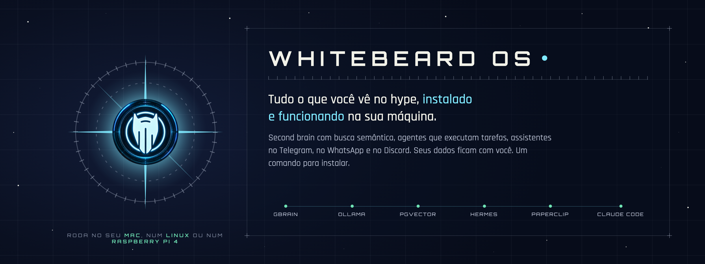
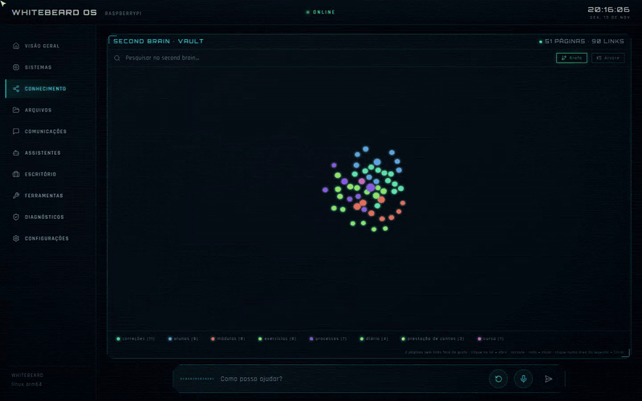
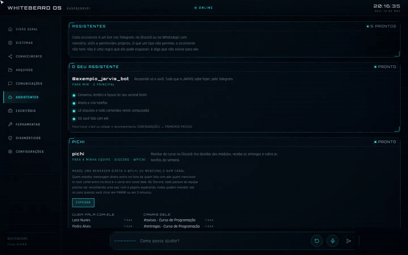
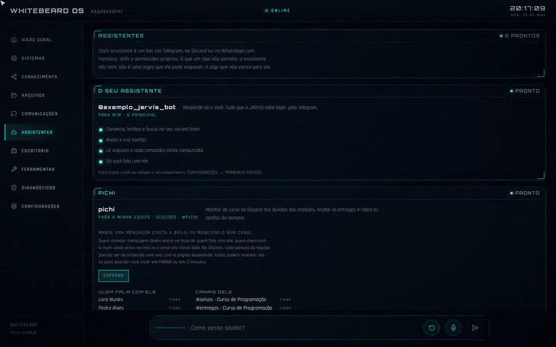
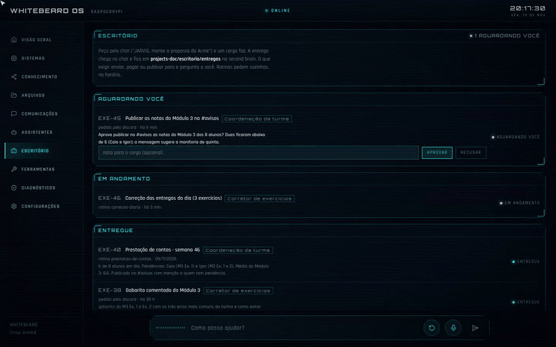
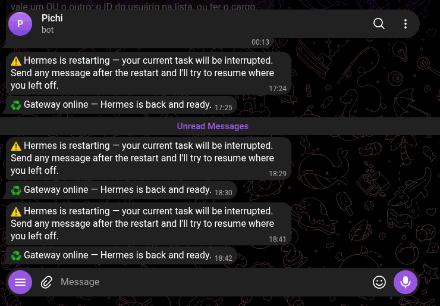
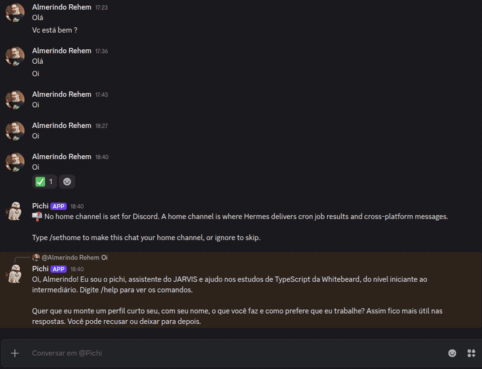
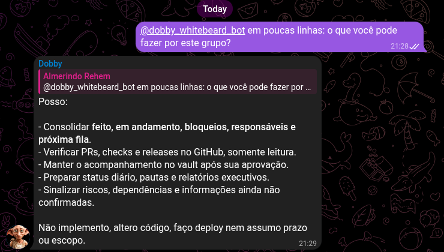
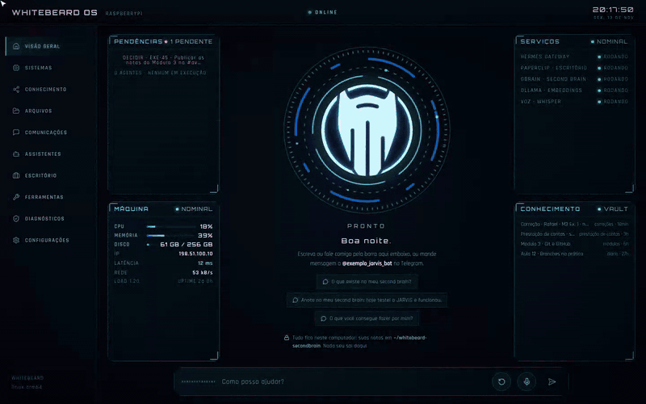

<p align="center"></p>

<p align="center"><a href="README.md">English</a> · <b>Português</b></p>

# Whitebeard OS

**Tudo o que você vê no hype, instalado e funcionando na sua máquina. Em um comando.**

Second brain com busca semântica. Agentes que trabalham sozinhos, no horário. Um bot no Telegram, outro no Discord,
outro no WhatsApp, cada um com a sua memória e as suas regras. Todo dia aparece alguém falando de uma dessas peças.
O difícil nunca foi saber que elas existem: é fazer todas trabalharem juntas, no seu computador, com os seus dados,
sem virar um projeto de fim de semana que nunca termina.

Eu sou **Almerindo Rehem**, engenheiro de software e fundador da **Whitebeard**. O Whitebeard OS é o setup que eu uso
todo dia, em casa e no trabalho, empacotado para você instalar com um comando e usar pelo navegador. Roda até num
**Raspberry Pi**.

```sh
curl -fsSL https://raw.githubusercontent.com/whitebeardit/whitebeard-os/main/install.sh | sh
```

<p align="center"></p>

<p align="center"><a href="#pergunte-ao-seu-second-brain">Second brain</a> ·
<a href="#um-bot-por-canal-em-três-toques">Bots por canal</a> ·
<a href="#cada-bot-com-o-seu-papel-e-o-seu-modelo">Tipos e modelos</a> ·
<a href="#o-escritório-trabalho-que-roda-sozinho">Escritório</a> ·
<a href="#no-telegram-e-no-discord-de-verdade">Telegram e Discord</a> ·
<a href="#do-seu-jeito">Temas</a> ·
<a href="#roda-onde-você-quiser">Instalar</a></p>

> **Um caso real.** As telas abaixo seguem um bot que já está no ar num Raspberry Pi: o **@Pichi**, monitor de um curso
> de programação no Discord. O plano do curso: tirar dúvidas dos módulos, corrigir os exercícios e, toda segunda-feira,
> publicar no canal a prestação de contas de cada aluno. As telas mostram essa configuração com alunos e notas
> fictícios; as conversas no Telegram e no Discord, no fim, são reais.

## Pergunte ao seu second brain

Suas notas em Markdown (abrem no Obsidian) viram um cérebro com busca semântica: embeddings gerados na sua máquina,
grafo de ligações, árvore de mapas e busca. O JARVIS e todos os bots consultam o mesmo cérebro. Nada sai do seu
computador.

<p align="center"></p>

## Um bot por canal, em três toques

Escolha para quem é e onde ele fala (Telegram, Discord ou WhatsApp), cole o token do bot e clique em ESPERAR: quem
mandar mensagem nesse intervalo entra na lista de quem fala com ele. Várias pessoas de uma vez, até você clicar em PARAR.

<p align="center"></p>

## Cada bot com o seu papel e o seu modelo

O limite de cada bot é estrutural: o que o tipo não permite, ele não tem instalado. Não é uma regra no prompt que ele
pode esquecer.

| Tipo | Para quê | No caso do curso |
| --- | --- | --- |
| **Para mim** | Um segundo assistente só seu | o JARVIS do dono, no Telegram |
| **Para a minha equipe** | Responde às pessoas que você liberar; consulta e anota no second brain | o @Pichi no Discord e a secretaria no WhatsApp |
| **Para um cliente** | Atende um grupo só sobre o papel dele, sem ferramentas | o grupo da empresa que patrocina as bolsas (e, de verdade, o grupo da Sauvvitech, logo abaixo) |
| **Só rotinas** | Não conversa; publica avisos no horário | o calendário da semana |

Cada bot também escolhe **a assinatura** (Claude ou ChatGPT, a sua, sem chave de API; ou modelos gratuitos pelo OpenRouter) e **o nível** (Rápido, Equilibrado
ou Mais capaz). A página mostra o modelo que cada escolha usa, e a outra assinatura conectada vira reserva automática.

<p align="center"></p>

## O Escritório: trabalho que roda sozinho

O trabalho que demora sai do chat. Você pede ao JARVIS, um **cargo** executa (um agente com papel definido) e a entrega
volta no chat e fica no second brain. **Rotinas** criam a tarefa sozinhas, no horário. O que exigir enviar, pagar ou
publicar **para e pergunta a você** antes.

No curso, o Escritório fica com três cargos e três rotinas:

| Rotina | Quando | Cargo | Onde publica |
| --- | --- | --- | --- |
| Correção das entregas do dia: corrige com a rubrica, aponta o erro com um exemplo e não entrega a resposta pronta | todo dia, 22h | Corretor de exercícios | no canal do @Pichi |
| Cobrança de tarefas: lembra quem ainda não entregou, com o prazo | quarta e sexta, 18h | Coordenação da turma | no canal do @Pichi |
| Prestação de contas: o que cada aluno entregou, o que está atrasado e a média | toda segunda, 9h | Coordenação da turma | no canal do @Pichi |

<p align="center"></p>

O uso de tokens aparece por assinatura, por cargo, por rotina e por tarefa, com alerta quando algo sai do padrão.

## No Telegram e no Discord, de verdade

O mesmo Pichi, rodando num Raspberry Pi, responde nos dois canais com a mesma memória e o mesmo second brain. Duas
dúvidas de aluno, em conversas diretas:

<table>
<tr>
<td width="45%" valign="top"><b>Telegram</b><br></td>
<td width="55%" valign="top"><b>Discord</b><br></td>
</tr>
</table>

### Num grupo de cliente

O **Dobby** atende o grupo **Whitebeard → Sauvvitech** no Telegram: um bot do tipo "Para um cliente", que acompanha o
projeto com quem está no grupo e sabe até onde vai. Perguntado no próprio grupo o que pode fazer:

<p align="center"></p>

## Do seu jeito

Três temas (HUD, Atlas estelar e Carmesim), tamanho do texto e voz, em CONFIGURAÇÕES. Muda na hora, neste aparelho.

<p align="center"></p>

## O que vem dentro

| Você ouviu falar de | No Whitebeard OS é |
| --- | --- |
| **Second brain** | O seu vault em Markdown (abre no Obsidian), sincronizado a cada 2 minutos com o **GBrain**, o cérebro que indexa tudo e responde por busca semântica |
| **Embeddings e pgvector** | **Ollama** rodando o modelo `bge-m3` na sua máquina; GBrain com PGLite no Mac e **pgvector** em Docker no Linux. Nada sai do seu computador |
| **MCP** | O cérebro entra como servidor MCP `knowledge` no Claude Code e em cada agente: todos consultam o mesmo second brain, com chave própria |
| **Agentes com tarefas autônomas** | O **Escritório**: você pede pelo chat, um cargo executa pelo **Hermes**, a entrega volta no chat e fica no vault. Rotinas rodam no horário. O que exigir enviar, pagar ou publicar para e pergunta a você |
| **Paperclip** | O motor de tarefas e aprovações por baixo do Escritório, já configurado |
| **Claude Code e ChatGPT** | A sua assinatura é a conta que os agentes usam (o login do Claude Code; o ChatGPT entra por código de dispositivo). Skills e MCPs já instalados |
| **Telegram, WhatsApp, Discord** | Assistentes isolados por público: um bot por canal, cada um com memória, skills, permissões e modelo próprios, criado em três toques |
| **Voz** | Fale com o assistente pela interface: transcrição local com Whisper e resposta falada em português |
| **Interface** | Uma página web no computador ou no celular (instala como app, com QR code): visão geral, conhecimento, assistentes, escritório, uso de tokens, diagnósticos |

## Roda onde você quiser

Roda num **Raspberry Pi**: é onde o Pichi mora, atendendo no Telegram e no Discord. Roda no Mac (Apple Silicon, sem Docker)
e em qualquer Linux. Interface, núcleo e conhecimento vão na mesma máquina por padrão, ou em máquinas separadas.

```sh
curl -fsSL https://raw.githubusercontent.com/whitebeardit/whitebeard-os/main/install.sh | sh
```

O instalador pergunta só o que falta, sobe tudo como serviço do usuário (sem senha de administrador) e abre a interface
no navegador. Atualizações chegam pela própria interface.

**O que você não precisa decidir:** banco vetorial, modelo de embeddings, pipeline de ingestão, prompt de sistema,
configuração de MCP, isolamento entre o bot do cliente e o da equipe. Está tudo decidido e testado.

## Para empresas

Este é o meu setup pessoal, grátis para uso pessoal. A mesma base atende uso corporativo: tenants por área,
assistentes por cliente, cargos por papel, second brain por equipe, tudo na sua infraestrutura. Uso comercial exige
licença ([detalhes](#licença)); fale com a Whitebeard: **[whitebeard.dev](https://whitebeard.dev)**.

<sub>Vai junto hoje: Hermes, Paperclip, GBrain, Ollama com `bge-m3`, Claude Code, Node 24, ffmpeg com Whisper; versões
fixadas em `kernel/versions.env`, licenças em [Componentes externos e licenças](#componentes-externos-e-licenças).
Telas gravadas com dados de exemplo; imagens e vídeos em alta resolução no
[kit de divulgação](docs/midia/README.md).</sub>

---

## Por dentro: o kernel instalável

Instala a arquitetura do JARVIS (Claude Code, skills, clientes MCP, Hermes) num host **zerado**, a partir de
uma declaração de tenant (`jarvis.yaml`), **sem carregar conhecimento nem dado privado de nenhuma empresa**.

Objetivo do projeto: pegar uma arquitetura de agentes que já roda em produção no dia a dia de uma empresa,
e transformá-la num **produto que outras pessoas baixam e instalam**. O primeiro usuário é a própria empresa
que o mantém (dogfooding); a estrutura já nasce de produto.

Este repositório é o **kernel**: mecanismo. Identidade (nomes, chats, contas, skills de negócio, segredos)
vive num **pacote de tenant** separado e privado, apontado na linha de comando. A regra que separa os dois:

> Mecanismo vai no kernel; identidade fica no tenant. Valor de tenant em código do kernel = falha de CI.

Três camadas:

| Camada | O que é | Onde vive | Exemplo |
| --- | --- | --- | --- |
| **kernel** | mecanismo obrigatório | este repositório | bootstrap, esquema do tenant, lint, skills de método |
| **packs** | mecanismo opcional, instalável | `packs/` (futuro) | CRM genérico, domínio fiscal BR, Instagram |
| **tenant** | identidade e dados | repositório privado do usuário | `jarvis.yaml`, skills de negócio, segredos |

## O pacote e onde cada parte roda

O pacote completo tem três papéis, e **por padrão os três são instalados na mesma máquina** (tudo-em-um).
Dividir em máquinas é opção, declarada em `nos:` no `jarvis.yaml`, não o padrão.

| Papel | Componentes | Precisa de |
| --- | --- | --- |
| **desktop** | Claude Code, skills, clientes MCP, JARVIS Web (UI no browser, construída do app e registrada como serviço de usuário), Hermes CLI | só `$HOME` e chave SSH com acesso ao repositório do app |
| **core** | Hermes (gateway Telegram + crons), Paperclip (Node + Postgres embutido) | host sempre ligado |
| **knowledge** | GBrain (MCP + ingestão do vault), pgvector, Ollama (embeddings), em Docker Compose | Docker (Linux) ou Docker Desktop/OrbStack (macOS) |

Sem `--role`, o `bootstrap.sh` instala os papéis do nó desta máquina em `nos:` do tenant: `local`, `localhost`
ou o nome do host (nome curto, ou o FQDN se o tenant o escrever com domínio). Sem `nos:`, os três: tudo-em-um; com
`nos:` mas sem nó que seja esta máquina, ele para e pede `--role`. Um papel em outra máquina é só outro host em `nos:` com os papéis dele; os MCPs e URLs do
tenant apontam para lá. Segredos obrigatórios que faltam são pedidos no terminal (`--no-prompt` desliga).
Sem Docker, o papel knowledge é adiado com aviso e os outros seguem.

**Camada de decisão com provedor plugável.** Rotear mensagens, classificar intents e aplicar guardrails são
perguntas fechadas, e o kernel as trata por uma abstração própria: perguntas tipadas versionadas, limiar de
confiança e escalada para o LLM ou para o humano. O tenant escolhe o provedor em `decisoes.provider`:
`regras` (determinístico, padrão), `llm` (modelos já configurados) ou `jev` (modelo de decisão da TypeSafe
AI, por API, com `TYPESAFE_API_KEY`). Nenhum provedor externo é obrigatório, e `perfis_excluidos` impede
que conteúdo de certos perfis saia da máquina.

**GPU é opcional, nunca obrigatória.** `aceleracao: auto` no `jarvis.yaml` detecta CUDA (Linux/NVIDIA),
Metal (Apple Silicon) ou Vulkan na instalação e cai para CPU se não houver. Onde a GPU entra: transcrição
(Whisper), embeddings e modelos locais (Ollama), vídeo das câmeras (hwaccel do FFmpeg). No Linux, o papel
knowledge em compose usa a GPU por CDI/NVIDIA Container Toolkit; no macOS, containers não veem a GPU, então
Ollama e Whisper rodam nativos e o compose aponta para eles.

A interface gráfica do produto é **uma só, a interface web do Whitebeard OS** (pacote `jarvis-web`; o JARVIS é o assistente com quem se fala nela), servida pelo próprio host e aberta no browser
(`http://localhost:8017` nesta máquina; na LAN ou no celular, `https://` com TLS local). Não há app Electron no produto: mesma UI, sem
empacotamento nem assinatura por sistema operacional. O app lê as pastas pelo mesmo contrato do `profile.sh`
(`JARVIS_HOME`, `JARVIS_DATA`, `HERMES_HOME`, `VAULT_PATH`), sem nome de tenant no código.

## Estado

Versão `0.2.0-dev`. Os três papéis instalam a partir do mesmo bootstrap:

- **desktop**: provado em CI (Ubuntu 24.04 e macOS), em Ubuntu descartável e num Mac físico (Apple Silicon,
  2026-11-01). O JARVIS Web vem pronto de [whitebeard-os-releases](https://github.com/whitebeardit/whitebeard-os-releases)
  (sem npm nem build na máquina de quem instala).
- **core**: Paperclip fixado no lockfile e instalado pelo npm do Node 24; Hermes upstream instalado por
  padrão; serviços de usuário registrados pelos próprios CLIs (`paperclipai onboard --install-service`,
  `hermes gateway install`). O CI prova instalação e renderização (`--no-start`); subir os serviços se prova
  no Mac físico.
- **knowledge**: no macOS (Apple Silicon) é nativo, sem Docker: GBrain com PGLite (Postgres embutido), Ollama
  na GPU (Metal) para os embeddings, token do MCP gerado na instalação e o second brain da pessoa
  (`~/whitebeard-secondbrain`, criado se não existir) sincronizado a cada 2 minutos. No Linux segue o compose
  com GBrain (tag fixa), pgvector e Ollama, portas só em localhost. O cérebro entra como MCP `knowledge` no
  Claude Code e no Hermes, e as skills `knowledge`, `knowledge-write` e `project-documentation` do kernel
  ensinam os dois a consultar e a documentar nele.

`satelite` (Hermes perfil + MCP em outra máquina) vem a seguir; o JARVIS Web já entra no papel desktop,
com TLS local, a partir do branch do app fixado no lockfile. Tenants no kernel: `pessoal`
(padrão de instalação) e `exemplo` (fictício, com todos os campos; usado no CI).

## Instalação em um comando (host zerado)

```sh
curl -fsSL https://raw.githubusercontent.com/whitebeardit/whitebeard-os/main/install.sh | sh
```

O `install.sh` garante git e curl (no macOS instala as Command Line Tools), clona o kernel em
`~/DEV/whitebeard-os` e roda o `bootstrap.sh` com o tenant `pessoal` (uma pessoa, um computador, tudo-em-um).
O que a pessoa faz:

1. roda o comando acima num terminal;
2. entra na conta Claude quando o navegador abrir (único passo interativo: Hermes e Paperclip usam esse login);
3. responde se quer o JARVIS no Telegram (pode dizer não e ligar depois);
4. no fim, o JARVIS Web abre sozinho no navegador, em `http://localhost:8017`, na página **PRIMEIROS PASSOS**:
   ali a pessoa liga o Telegram (cola o token do bot e manda um "oi"), preenche as chaves que o tenant pede,
   vê como abrir no celular e aplica. Nada disso volta ao terminal: a página chama
   `kernel/bin/jarvis_setup.py` (estado e gravação, só por stdin) e `bootstrap.sh --apply` (render, MCPs e
   Hermes, sem reinstalar nada). A página fica em CONFIGURAÇÕES para voltar depois.

Nada de chaves, convites ou arquivos para editar. O que não é nosso (npm, instalador do Hermes, Paperclip)
não aparece na tela: fica em `~/.jarvis/logs/`. Tenant de uma empresa: `JARVIS_TENANT=<nome, pasta ou
/caminho/jarvis.yaml>` antes do comando (`tenants/exemplo` mostra todos os campos). Para refazer a
instalação, rode o mesmo comando de novo: é idempotente.

**Assistentes.** Além do bot do dono, o tenant pode declarar `assistentes:` — um bot por público,
cada um um **perfil isolado do Hermes** (token, memória, skills, ferramentas e sessões próprias), servidos pelo
mesmo gateway. Quatro tipos, com o limite posto por estrutura (o que o tipo não permite, o assistente não tem
instalado): `mim` (tudo, como o do dono), `equipe` (skills e MCPs, escreve no second brain, sem computador),
`cliente` (só as skills do papel, sem ferramentas nem MCPs, responde só no grupo permitido e com menção) e
`rotinas` (não conversa). O render escreve um perfil por assistente em `render/hermes/assistentes/<nome>/`, o
bootstrap cria o perfil (`hermes profile create`) e aplica config, variáveis, persona (`SOUL.md`) e skills
(`kernel/bin/jarvis_assistente.py`); o token entra em `secrets.env` como `TELEGRAM_BOT_TOKEN_<NOME>` (PRIMEIROS
PASSOS mostra com título), pessoas e grupos como `TELEGRAM_ALLOWED_USERS_<NOME>` e `TELEGRAM_GROUP_ALLOWED_CHATS_<NOME>`.
`canal: discord` põe o mesmo assistente num bot do Discord (`DISCORD_BOT_TOKEN_<NOME>`, `DISCORD_ALLOWED_USERS_<NOME>`,
`DISCORD_ALLOWED_CHANNELS_<NOME>`); `canal: whatsapp` usa a ponte do Hermes (Baileys, não oficial): sem token, a sessão é
pareada por QR na página ASSISTENTES e fica em `$JARVIS_HOME/assistentes/<nome>/whatsapp/session`
(`whatsapp_modo: bot` com número dedicado, ou `self-chat` com o próprio número); sem `canal`, é Telegram. Assistente que sai do tenant é estacionado, nunca apagado.
`tenants/exemplo` mostra os dois tipos mais comuns e um assistente no Discord.

**Atualizações** chegam pelo próprio JARVIS Web: uma vez por dia ele pergunta ao kernel se a origem no GitHub
tem commit novo ou pacote novo do JARVIS Web (`jarvis_setup.py update-check`, resposta guardada em
`~/.jarvis/update.json`) e, se tiver, mostra a faixa "ATUALIZAÇÃO DISPONÍVEL" com as notas da release e os botões
ATUALIZAR / DEPOIS (também em CONFIGURAÇÕES, com VERIFICAR AGORA). ATUALIZAR roda o `install.sh` desacoplado do
serviço (`update-run`: unidade própria do systemd no Linux, sessão própria no macOS, porque o JARVIS Web é
reiniciado no meio), com registro em `~/.jarvis/logs/update.log`; a página acompanha (`update-status`), espera o
servidor voltar e recarrega. Tenant, segredos, vault e dados não são tocados. Pelo terminal é o mesmo comando da
instalação.

Para desinstalar: `~/DEV/whitebeard-os/uninstall.sh` remove serviços e programas e **mantém** o second brain e o
`secrets.env` (com `--delete-data`, remove também os dois). O Claude Code e o seu login nunca são tocados.

Passo a passo, sem o instalador:

```sh
cd ~/DEV/whitebeard-os
./bootstrap.sh --tenant tenants/exemplo/jarvis.yaml --dry-run                   # só valida e mostra o plano
./bootstrap.sh --tenant tenants/exemplo/jarvis.yaml                             # papel desktop
./bootstrap.sh --tenant tenants/exemplo/jarvis.yaml --role desktop,core,knowledge   # tudo-em-um
```

Opções em `./bootstrap.sh --help` (`--role`, `--no-start`, `--with-hermes`, `--skip`, `--home`, `--apply` para
só reaplicar a configuração de uma instalação feita). O CI roda com `--skip web` porque o repositório do app é
privado e o runner não tem a chave; num host seu, o JARVIS Web entra no papel desktop e atende em
`http://localhost:8017` nesta máquina (sem aviso de certificado) e em `https://<host>:8017` na rede local
(token em `$JARVIS_DATA/jarvis-web.json`; certificado autoassinado em `~/.jarvis/tls`, que o celular instala
para liberar o microfone; a página PRIMEIROS PASSOS oferece o arquivo).

O bootstrap é idempotente e só escreve dentro de `$HOME`:

| Onde | O quê | Papel |
| --- | --- | --- |
| `~/.jarvis/` (`$JARVIS_HOME`) | `jarvis.yaml` (cópia), `secrets.env` (600), `profile.sh`, `render/`, `skills/`, `tools/` (ffmpeg; no macOS também bun, ollama e gbrain), `compose/knowledge/` (Linux) | todos |
| `~/whitebeard-secondbrain/` (`$VAULT_PATH`) | o second brain: vault Markdown (Obsidian) com `tenants/<tenant>/{projects-doc,knowledge-domain,resources}`; git local com commits automáticos | todos |
| `$JARVIS_DATA` (`dados:` do tenant, padrão `~/.jarvis/data`) | dados do tenant: posts, métricas, contratos, registros e token do JARVIS Web | todos |
| `~/.local/bin/` | `uv`, `claude`, `ffmpeg`, `ffprobe` | todos |
| `~/.jarvis/app/jarvis-web/` | JARVIS Web do pacote fixado no lockfile (link para `jarvis-web-<versão>/`); serviço `jarvis-web` (systemd de usuário) ou LaunchAgent `dev.whitebeard.jarvis-web` lendo `web.env` | desktop |
| `~/.jarvis/tls/` | certificado autoassinado do JARVIS Web (SAN: localhost, host, IPs); o serviço sobe em HTTPS | desktop |
| `~/.nvm/` | Node na versão do lockfile; `paperclipai` instalado nele | todos / core |
| `~/.claude/skills/<nome>`, `~/.hermes/skills/<nome>`, `~/.claude.json` | links para as skills (Claude Code e Hermes); servidores MCP do tenant e o `knowledge` local | desktop / core |
| `~/.claude/plugins/` | marketplaces e plugins do Claude Code declarados em `claude:` do tenant (ex.: `sherlock-holmes@whitebeard-plugins` para o módulo rastreamento) | desktop |
| `~/.hermes/` | Hermes upstream (tag fixa); `config.yaml` inicial e `.env` do tenant, sem sobrescrever | core (ou `--with-hermes`) |
| `~/.paperclip/` | instância do Paperclip (Postgres embutido); no tudo-em-um fica só nesta máquina, sem login, com empresa, conexão Claude e agente CEO criados na instalação | core |
| `~/.gbrain/` + LaunchAgents `dev.whitebeard.{ollama,gbrain,vault-sync}` | macOS: cérebro PGLite, Ollama nativo e a sincronização do second brain | knowledge |
| Docker | Linux: projeto `whitebeard-knowledge`: GBrain, pgvector, Ollama, volumes próprios | knowledge |
| `~/.zshrc` / `~/.bashrc` | uma linha: `. "$JARVIS_HOME/profile.sh"` | todos |

## Layout

```
bootstrap.sh                 entrada única (POSIX sh; Linux e macOS); --role desktop,core,knowledge
install.sh                   instalação em um comando (clona o kernel e chama o bootstrap)
kernel/
  versions.env               lockfile: node, nvm, uv, Claude Code, Hermes, Paperclip, GBrain, imagens, FFmpeg
  schema/jarvis.schema.json  contrato do jarvis.yaml
  secrets/manifest.yaml      segredos do kernel: nome, papel, como obter (nunca valores)
  bin/jarvis_render.py       valida o tenant e gera secrets.env, profile.sh, MCP, skills, hermes/, knowledge.env
  bin/privacy_lint.py        falha se houver identidade de tenant, caminho de usuário ou segredo no kernel
  compose/knowledge/         GBrain + pgvector + Ollama (compose, Dockerfile, entrypoint, sobreposição GPU)
  skills/                    skills do kernel (mecanismo puro)
tenants/exemplo/             tenant fictício: usado pelo CI e copiado por quem começa do zero
docs/validacao-macos.md      roteiro de validação no Mac zerado
docs/validacao-macos-agente.md  o mesmo roteiro, escrito para o Claude Code do próprio Mac executar
test/docker-ubuntu.sh        mesma validação numa Ubuntu 24.04 descartável
```

## Levar tudo para outra máquina: exportar e importar

```sh
uv run kernel/bin/wb_export.py --dry-run                 # lista stores e tamanhos
uv run kernel/bin/wb_export.py --sem financeiro          # bundle .tar.gz (modo 600) + .sha256, sem o grupo "financeiro" do tenant
# na máquina nova, depois do bootstrap com o mesmo tenant:
uv run kernel/bin/wb_import.py whitebeard-export-*.tar.gz
```

Stores: `jarvis` (`$JARVIS_HOME` sem o que é regenerável), `dados` (`$JARVIS_DATA`, sem os tokens por máquina), `hermes` (sem código, caches e tokens por máquina),
`paperclip` (config, arquivos e o backup de banco mais recente), `knowledge` (dump do Postgres e home do GBrain,
se o compose estiver no ar), `claude` (configurações) e `vault` (só referência ao git, ou conteúdo com
`--with-vault`). Segredos ficam de fora por padrão (`--with-secrets` para incluir); o import nunca sobrescreve
`secrets.env` nem `.env` existentes. O tenant declara em `exportacao.grupos` os globs que podem ficar de fora
(ex.: financeiro). O CI exporta e importa num HOME alternativo a cada execução.

## O que entra no `jarvis.yaml`

Parâmetros do tenant: identificador, idioma, pasta de dados (`dados`), módulos do JARVIS Web (`interface`),
vault, servidores MCP, pacotes de skills, modelo do Hermes, perfis, crons, serviços monitorados, nós, assistentes
(`assistentes`) e o Escritório (`escritorio`: ligado, cargos, rotinas). Segredos **nunca** entram no yaml: entram como `${NOME}` e são
preenchidos em `secrets.env` a partir do manifesto. Esquema completo em `kernel/schema/jarvis.schema.json`;
exemplo em `tenants/exemplo/jarvis.yaml`.

### Quem pensa (Claude ou ChatGPT, pela sua assinatura)

`hermes.provedor` (`claude` ou `chatgpt`) e `hermes.nivel` (`rapido`, `equilibrado`, `capaz`) escolhem o modelo de
todos: o JARVIS, os assistentes e os cargos. A pessoa nunca vê ids de modelo: a tabela provedor × nível fica em
`kernel/modelos.yaml` e muda por release. O Claude usa o login do Claude Code; o ChatGPT entra pela página
(PRIMEIROS PASSOS → QUEM PENSA) com um código de dispositivo do Hermes (`openai-codex`). Com as duas contas, a outra
vira reserva automática no mesmo nível. O **OpenRouter** (`openrouter`) é a terceira opção: entra por chave de API, colada
na mesma página, e os três níveis usam modelos gratuitos (com o limite diário de pedidos do OpenRouter). Assistentes e cargos aceitam `nivel` próprio, e assistentes também a própria
assinatura; `modelo` explícito continua
valendo para quem é técnico. A escolha da página fica em `$JARVIS_HOME/pensa.json` e vale depois de colocar em uso.

### O Escritório (cargos e rotinas)

Com `escritorio.ligado: true`, o trabalho que demora sai do chat: "JARVIS, monte a proposta da Acme" vira uma
tarefa, um **cargo** executa (um perfil do Hermes com as ferramentas de um assistente de equipe, sem terminal, pelo
Paperclip por baixo), a entrega fica em `projects-doc/escritorio/entregas/` no second brain e volta no chat de origem
pelo carteiro (`kernel/bin/jarvis_carteiro.py`, a cada minuto). O que exigir enviar, pagar ou publicar para e pergunta.
O cargo `trabalho` (Assistente de trabalho) existe sempre; outros cargos entram em `escritorio.cargos` (ou pela página
ESCRITÓRIO) e passam a valer depois de "colocar em uso". **Rotinas** (`escritorio.rotinas` ou pela página) criam a
tarefa sozinhas no horário (cron de 5 campos, fuso do computador) e publicam a entrega na sua conversa com o JARVIS
(`onde: telegram`) ou no grupo de um assistente (`onde: assistente:<nome>`); valem na hora, sem colocar em uso. A rotina
`resumo-da-semana` (segunda, 8h) vem por padrão.

## Componentes externos e licenças

| Componente | Licença | Como entra |
| --- | --- | --- |
| Hermes Agent (NousResearch) | MIT | instalador upstream em tag fixa |
| Paperclip | MIT | npm, versão fixa, instalado no Node do lockfile (papel core) |
| GBrain, pgvector, Ollama | MIT (GBrain), PostgreSQL, MIT (Ollama) | compose do papel knowledge; GBrain construído da tag fixa |
| Claude Code | proprietário (Anthropic) | instalador oficial; cada usuário usa a própria conta |
| FFmpeg 9.0 | LGPL | build próprio com o filtro Whisper (whisper.cpp), publicado em [whitebeard-os-releases](https://github.com/whitebeardit/whitebeard-os-releases) com sha256: macOS arm64 com GPU Metal e avfoundation (câmera e microfone), Linux x86_64 estático em CPU (workflow `ffmpeg-whisper.yml`); demais plataformas: build estático de terceiros fixado por URL, sem Whisper |
| Modelos (Anthropic, OpenAI, outros) | contas do usuário | chaves e logins só em `secrets.env` e OAuth local |

## Licença

**Grátis para uso pessoal. Uso comercial exige licença.** O Whitebeard OS está sob a
[Whitebeard OS Personal Use License](LICENSE): uma pessoa física pode baixar, instalar, modificar e usar nas próprias
máquinas, para fins pessoais e não comerciais. Uso por ou para empresa ou organização, em trabalho remunerado ou para
clientes, nas operações de um negócio, ou oferecer o Software (ou serviços baseados nele) a terceiros exige licença
comercial: **[whitebeard.dev](https://whitebeard.dev)**. Os componentes de terceiros que o kernel instala (Hermes,
Paperclip, GBrain, Ollama e os demais da tabela acima) seguem as próprias licenças.

## Regras do repositório

- Nenhum caminho absoluto de usuário, nome de cliente, chat id, conta de nuvem ou token no kernel.
  `uv run kernel/bin/privacy_lint.py` roda no CI; um pacote de tenant roda o mesmo lint com a própria lista
  de termos proibidos (`--denylist`), que não fica aqui.
- Versões só mudam em `kernel/versions.env`.
- Hosts em produção não são alterados por este repositório. A instalação se prova primeiro em host zerado
  (CI, VM descartável, máquina nova).
